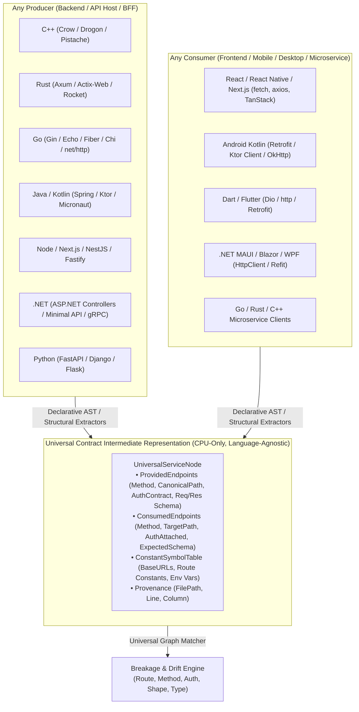

# Universal AST Contract Engine & Dual-Mode Agentic IDE Blueprint

> **Status:** Approved Backend Architecture + Next-Gen Dual-Mode IDE UI Specification  
> **Zero-GPU Guarantee:** All project discovery, symbol propagation, route/client extraction, DTO schema comparison, and Auth contract verification operate 100% deterministically on the CPU.

---

## Part 1: Universal Multi-Language AST & Contract Backend Plan

### 1.1 Universal Contract Intermediate Representation (UIR)
Instead of hardcoding `switch` statements per stack or restricting a project to *only* "frontend" or *only* "backend", every discovered project in the workspace is represented as a **Dual-Role `UniversalServiceNode`** (can both **produce** routes and **consume** routes).



### 1.2 Three-Tier CPU Extraction Pipeline
1. **Tier 1 — Explicit Contracts (Zero-Effort):**
   * OpenAPI / Swagger (`swagger.json`, `openapi.yaml`), Protobuf (`.proto`), GraphQL (`.graphql`).
2. **Tier 2 — Cross-Language Constant & Symbol Propagation:**
   * Scans constants/enums across files (`constexpr`, `#define`, `const`, `static final`, `enum`) to resolve indirect paths like `CROW_ROUTE(app, Routes::LOGIN)` or `dio.post(ApiEndpoints.lines)` before matching.
3. **Tier 3 — Declarative Multi-Language Extractor Matrix (`languages.json` + AST Walkers):**

| Ecosystem | Manifests | Producer (Route) Patterns | Consumer (Client Call) Patterns | Auth & Middleware Patterns | Data / DTO Structs |
| :--- | :--- | :--- | :--- | :--- | :--- |
| **C++ (Crow / Drogon / httplib)** | `CMakeLists.txt`, `vcpkg.json`, `conanfile.txt`, `Makefile` | `CROW_ROUTE(app, "/path").methods("POST"_method)`<br>`CROW_BP_ROUTE(bp, "/path")`<br>`ADD_METHOD_TO(Ctrl::fn, "/path", Post)` | `cpr::Get(cpr::Url{...})`<br>`httplib::Client.Post("/path")`<br>`curl_easy_setopt(..., CURLOPT_URL)` | `Crow<AuthMiddleware>`<br>`req.get_header_value("Authorization")` | `struct Name { ... }`<br>`nlohmann::json` keys (`j["field"]`)<br>`crow::json::rvalue` |
| **Rust (Axum / Actix / Rocket)** | `Cargo.toml` | `.route("/path", get(fn).post(fn))`<br>`#[get("/path")]`, `#[post("/path")]` | `reqwest::Client::get("/path")`<br>`client.post(url).bearer_auth(...)` | `.layer(RequireAuthorizationLayer)`<br>`TypedHeader<Authorization<Bearer>>` | `#[derive(Serialize, Deserialize)] struct Name { pub field: Type }` |
| **Go (Gin / Echo / Fiber / Chi / stdlib)** | `go.mod` | `r.GET("/path", fn)`, `e.POST("/path", fn)`<br>`app.Get("/path", fn)`<br>`mux.HandleFunc("POST /path", fn)` | `http.Get(...)`, `http.NewRequest(method, url, ...)`<br>`resty.R().SetAuthToken(...).Post("/path")` | `r.Use(AuthMiddleware())`<br>`c.GetHeader("Authorization")` | `type Name struct { Field Type \`json:"field"\` }` |
| **Java & Kotlin (Spring / Ktor / Retrofit)** | `pom.xml`, `build.gradle`, `build.gradle.kts` | `@GetMapping("/path")`, `@PostMapping`<br>`routing { get("/path") { ... } }` (Ktor) | **Retrofit:** `@GET("path") suspend fun ...`<br>**Ktor/OkHttp:** `client.get("path")`<br>**Spring:** `RestTemplate` / `WebClient` | `@PreAuthorize("hasRole('...')")`<br>`@Secured`, `authenticate("auth-jwt")`<br>Retrofit `@Header("Authorization")` | `data class Name(val field: Type)`<br>`record Name(...)`<br>`class NameDto` |
| **JS / TS (React, React Native, Next.js, NestJS, Express)** | `package.json`, `app.json`, `next.config.*` | **Next.js App Router:** `app/api/**/route.ts` (`export async function GET/POST`)<br>**NestJS:** `@Controller('x')` + `@Get('y')`<br>**Express/Fastify:** `app.get('/x')` | `fetch('/path')`, `axios.get<T>('/path')`<br>`useQuery(..., () => api.get('/path'))` | `NextAuth` / `getServerSession` / `middleware.ts`<br>NestJS `@UseGuards(JwtAuthGuard)`<br>Axios `interceptors.request` (`Bearer`) | `interface Name { field: type }`<br>`type Name = { ... }`<br>`z.object({ ... })` (Zod) |
| **Dart / Flutter** | `pubspec.yaml` | `Shelf` / `Dart Frog` (`routes/index.dart`) | `dio.get('/path')`, `http.post(Uri.parse(...))`<br>Retrofit.dart `@GET('/path')` | `InterceptorsWrapper` (`options.headers['Authorization']`) | `class Name { final Type field; factory Name.fromJson(...) }` |
| **.NET (ASP.NET Core, MAUI, Blazor)** | `*.csproj`, `*.sln` | `[Route("...")]` + `[HttpGet("...")]`<br>`app.MapGet("/path", ...)` | `HttpClient.GetAsync`, `PostAsJsonAsync<T>`<br>**Refit:** `[Get("/path")]` | `[Authorize(Roles = "...")]`, `[AllowAnonymous]`<br>`.RequireAuthorization()`<br>`DefaultRequestHeaders.Authorization` | `public record/class NameDto { public Type Prop { get; set; } }` |
| **Python (FastAPI, Django, Flask)** | `pyproject.toml`, `requirements.txt` | `@app.get("/path")`, `@router.post("/path")`<br>Django `path("route/", view)` | `requests.get(url)`, `httpx.AsyncClient().post(url)` | `Depends(get_current_user)`<br>`@login_required`, `IsAuthenticated` | `class Name(BaseModel): field: type` (Pydantic) |

### 1.3 Canonical Type & Auth Breakage Rules
Every extracted field is normalized to `CanonicalType` (`Integer`, `Float`, `String`, `Boolean`, `Object`, `Array<T>`, plus `IsNullable`).
The `ContractMatcher` flags 5 deterministic break categories:
1. **`MissingEndpoint`** — Client calls a route that no service in the workspace exposes.
2. **`MethodMismatch`** — Client sends `POST`, service exposes `PUT` or `GET`.
3. **`AuthBreakage`** —
   * *Missing Auth:* Route requires `[Authorize]` / `AuthMiddleware` / `JwtAuthGuard`, client call uses an unauthenticated client.
   * *Scheme Mismatch:* Route expects Cookie Session, client sends `Authorization: Bearer`.
   * *Role/Scope Mismatch:* Route requires a role/claim not requested by the client's auth flow.
4. **`PayloadFieldMismatch`** — Missing required request/response fields or casing drift (`snake_case` vs `camelCase`).
5. **`TypeOrNullabilityMismatch`** — E.g., Backend returns `Float` or nullable `String?`, Client expects non-null `Integer`.

---

## Part 2: UI Diagnosis & Dual-Mode IDE Architecture (Editor Mode + Agent Mode)

### 2.1 Diagnosis of Current UI Problems in `Syncro.Desktop`

After inspecting [`IdeShell.razor`](file:///d:/DeveloperAI/DEVOLOPER/Syncro.Desktop/Components/IDE/IdeShell.razor), [`MainLayout.razor`](file:///d:/DeveloperAI/DEVOLOPER/Syncro.Desktop/Components/Layout/MainLayout.razor), [`UniverseScan.razor`](file:///d:/DeveloperAI/DEVOLOPER/Syncro.Desktop/Components/Pages/Connector/UniverseScan.razor), [`AgentTaskDashboard.razor`](file:///d:/DeveloperAI/DEVOLOPER/Syncro.Desktop/Components/Pages/Projects/AgentTaskDashboard.razor), and [`AiAgentPanel.razor`](file:///d:/DeveloperAI/DEVOLOPER/Syncro.Desktop/Components/Dashboard/AiAgentPanel.razor), there are **6 core UX/UI problems** holding the platform back:

1. **Fragmented AI Experiences (4 Disconnected Agent UIs):**
   * [`AiAgentPanel.razor`](file:///d:/DeveloperAI/DEVOLOPER/Syncro.Desktop/Components/Dashboard/AiAgentPanel.razor) on the Home page is a batch-script form.
   * [`AgentTaskDashboard.razor`](file:///d:/DeveloperAI/DEVOLOPER/Syncro.Desktop/Components/Pages/Projects/AgentTaskDashboard.razor) is a PM task viewer.
   * [`CliTalk.razor`](file:///d:/DeveloperAI/DEVOLOPER/Syncro.Desktop/Components/Pages/Projects/CliTalk.razor) is a CLI chat page.
   * [`IdeShell.razor`](file:///d:/DeveloperAI/DEVOLOPER/Syncro.Desktop/Components/IDE/IdeShell.razor#L186-L210) has a tiny plain-text `textarea` portal (`blazor-ai-portal`) that only dumps raw `TaskLoopEngine` status strings (`Task 123: pending -> running -> done`) with no tool call cards, no file diffs, no `@` context pills, and no approval buttons.
2. **Single-Folder Limitation in `IdeShell.razor`:**
   * `State.Current` in [`IdeShell.razor`](file:///d:/DeveloperAI/DEVOLOPER/Syncro.Desktop/Components/IDE/IdeShell.razor#L81-L103) only understands **one folder at a time**. When working on a multi-project ecosystem (e.g., Web Portal + Flutter + MAUI + C++ Crow), you cannot see all projects, their running status, or their contract breaks inside the IDE tree.
3. **Disconnected Multi-Project Map (`UniverseScan.razor` vs `IdeShell.razor`):**
   * [`UniverseScan.razor`](file:///d:/DeveloperAI/DEVOLOPER/Syncro.Desktop/Components/Pages/Connector/UniverseScan.razor) has a great SVG connection graph and route/call tables, but it lives in the main window, completely isolated from the IDE! Clicking a broken connection in `UniverseScan.razor` doesn't open the file line in the editor or let the Agent fix both sides.
4. **No Dual-Mode Switch (Editor-Centric vs. Agent-Centric / Mission Control):**
   * Modern agentic IDEs (Antigravity 2.0, Cursor, Claude Code, Windsurf) give you **two distinct, instant-toggle workspaces**:
     * **Mode 1: IDE / Code Mode (Cursor / Antigravity Editor style)** — Code editor (`code-oss` / Monaco) is front-and-center (75% width) with a smart **Agent Composer & Contract Sidebar** on the right (25% width).
     * **Mode 2: Agent / Mission Control Mode (Antigravity 2.0 / Claude Code style)** — The autonomous Agent, Multi-Project Universe Map, Live Execution Plan, Diff Review Carousel, and Terminal Streams take center stage for orchestrating changes across multiple repos simultaneously.
5. **Double-Chrome Clash When `code-oss` Runs Inside `IdeShell.razor`:**
   * `IdeShell.razor` renders its own Activity Bar (`SuiActivityBar`), its own File Explorer (`blazor-explorer-portal`), and its own Status Bar (`SuiStatusBar`), and then embeds `code-oss` inside a GoldenLayout tab (`blazor-codeoss-portal`), which *also* has its own Activity Bar, Explorer, and Status Bar. This creates confusing nested sidebars.
6. **Theme Split (Light Main Shell vs. Dark IDE):**
   * `MainLayout.razor` forces `IsDarkMode="false"` (`#F1F5F9` light theme), while `IdeShell.razor` uses dark CSS tokens (`var(--bg-editor)`), making window transitions jarring.

---

### 2.2 The New Unified Dual-Mode UI Architecture

We restructure the IDE into a **Unified Multi-Project Workbench** with a **Top Center Mode Switcher**:
`[ 💻 Editor Mode ]  |  [ 🤖 Agent Mission Control ]  |  [ 🕸️ Universe Graph ]`

```
┌──────────────────────────────────────────────────────────────────────────────────────────────────────┐
│ ≡  SYNCRO   [Workspace: Mooring Ecosystem (4 Projects) ▾]    [ 💻 Editor | 🤖 Agent | 🕸️ Universe ] │
│                                                              [ ▶ Run Wave ] [ 🛡️ 2 Breaks ] [⚙]      │
├────┬──────────────────────┬─────────────────────────────────────────────┬────────────────────────────┤
│    │ MULTI-PROJECT TREE   │  CENTER VIEWPORT (Switches by Mode)         │ SYNCRO AGENT COMPOSER      │
│ 📁 │                      │                                             │ [Chat] [Composer] [Verify] │
│    │ ▼ 🌐 mooring-portal  │  • In EDITOR MODE:                          │                            │
│ 🕸️ │   (Next.js • :3000)  │    Full-bleed Code-OSS / Monaco Editor      │ @mooring-portal @flutter   │
│    │   🟢 18 Routes       │    with inline Contract CodeLens & Squiggles│                            │
│ 🛡️ │                      │                                             │ ┌────────────────────────┐ │
│    │ ▼ 📱 mooring-flutter │  • In AGENT MODE (Antigravity 2.0 / Claude):│ │ ✓ Scanned 4 projects   │ │
│ 🤖 │   (Flutter • Dio)    │    - Multi-Step Execution Plan & Subagents  │ │ ⚠️ Found Auth Mismatch │ │
│    │   🔴 1 Auth Break    │    - Cross-Project Side-by-Side Diff Viewer │ │   in LineService.cs:42 │ │
│ ▶️ │                      │    - Live Verification (Build + Test Gate)  │ │ [Apply Fix Across 2]   │ │
│    │ ▼ 🖥️ mooring-maui    │                                             │ └────────────────────────┘ │
│    │   (.NET 9 MAUI)      │  • In UNIVERSE MODE:                        │                            │
│    │   🟡 1 Shape Drift   │    Interactive N-Project Architecture Canvas│ [Ask or @file / @project…] │
│    │                      ├─────────────────────────────────────────────┤ [⚡ Auto-Verify]    [Send] │
│    │ ▼ ⚙️ crow-telemetry  │  UNIFIED BOTTOM DOCK                        │                            │
│    │   (C++ Crow • :8080) │  [ ⚠️ Problems & Contract Breaks (3) ] [ 终端 Multi-Terminal ] [ Output ] │
├────┴──────────────────────┴─────────────────────────────────────────────┴────────────────────────────┤
│ 🟢 MCP Bridge :9877 (17 Servers)  │ 🔗 42 Matched · 🔴 1 Auth Break · 🟡 2 Drift │ ⚡ CPU AST Ready │
└──────────────────────────────────────────────────────────────────────────────────────────────────────┘
```

---

### 2.3 Detailed Design of the Two Core Modes

#### Mode A: **IDE / Editor Mode** (Cursor + Antigravity IDE Experience)
Designed for hands-on coding across multiple projects with instant AI & AST assistance:
1. **Smart Multi-Project Explorer (Left Sidebar):**
   * Groups files by discovered sub-project (`mooring-portal`, `mooring-flutter`, `mooring-maui`, `crow-telemetry`) with stack badges, live port/health indicators (`🟢 :8080`), and inline badge counts for broken contracts (`🔴 1`).
   * **Zero Double-Chrome:** When `CodeOssIdeHost` is active, we pass the generated `.code-workspace` so `code-oss` handles the editor/file tree natively, while Syncro provides the `syncro-bridge` Universe Sidebar & Right Agent Dock.
2. **Inline Contract CodeLens & Diagnostics (Center Editor):**
   * Above any route (C++ `CROW_ROUTE`, Rust `.route`, C# `[HttpPost]`, Next.js `POST`):
     `🔗 2 Consumers: mooring-flutter ✓ | mooring-maui 🔴 AuthMissing (LineService.cs:42) — [Click to Diff] [🤖 Auto-Fix]`
   * Hovering a red squiggle on a client call shows the exact schema/auth diff against the backend route.
3. **Contextual Agent Dock (Right Sidebar):**
   * Supports **`@project`**, **`@file`**, **`@endpoint`**, and **`@break`** context pills.
   * Renders rich **Tool Call Cards** (e.g., `🔧 MapContracts`, `🔧 ResolveBackendContract`, `🔧 ApplyPatch`), **Collapsible Inline Diffs**, and **One-Click Verify & Apply** (backed by `VerificationEngine` so broken builds auto-rollback).

#### Mode B: **Agent Mission Control Mode** (Antigravity 2.0 / Claude Code Experience)
Designed for autonomous multi-repo engineering, feature scaffolding, and cross-project repair without touching files manually:
1. **Left Column — Active Mission & Project Scope Selector:**
   * Shows the active multi-project workspace, checkboxes to scope which projects the agent is allowed to touch, and a live list of **Contract & Auth Breakages** that can be queued into the agent with one click (`[Fix All 3 Breaks]`).
2. **Center Column — Live Execution Stream & Multi-Project Diff Canvas:**
   * **Step-by-Step Task Graph:** Visualizes `TaskPlanner` / `McpOrchestrator` steps in real time (`1. Scan AST Contracts ✓` → `2. Patch C++ Crow DTO ✓` → `3. Update Flutter Model ✓` → `4. Run Verification Build 🔄`).
   * **Cross-Project Diff Carousel:** Side-by-side synchronized diffs showing how a single feature or fix touches *both* the producer (e.g., `crow-telemetry/main.cpp`) and the consumer (e.g., `mooring-flutter/lib/api.dart`) before you click **Approve & Commit**.
   * **Terminal & Wave Runner Drawer:** Embedded live output from `GroupRunOrchestrator` showing all services booting in dependency waves (Wave 0 DB → Wave 1 Backend → Wave 2 Mobile/Web).
3. **Right Column — Hindsight Memory & Verification Gate:**
   * Shows real-time **Verification Engine** status (`Errors Before: 0 → Errors After: 0 | Tests: Passed ✓`).
   * Shows **Hindsight Vector Matches** (past repairs from `RepairDatabaseService` that match current compiler/contract errors).

---

## Part 3: Phased Implementation Roadmap

### Phase 1: Dual-Mode IDE UI & Agent Mission Control (`Components/IDE/`)
1. **Upgrade `IdeShell.razor`** with the **Top Mode Switcher (`Editor | Agent | Universe`)**.
2. **Build the Multi-Project Sidebar & Embedded Universe Graph** inside the IDE so you don't have to leave the IDE to run `MultiProjectScanService` or inspect contract/auth breaks.
3. **Replace the basic `blazor-ai-portal` textarea** with a structured **Antigravity/Claude-Code style Agent Composer & Mission Control view** featuring:
   * Context chips (`@project`, `@endpoint`, `@problems`)
   * Real-time MCP Tool Call cards (`McpOrchestrator` + `TaskLoopEngine` integration)
   * Cross-file Patch Preview & `VerificationEngine` Approve/Rollback controls.

### Phase 2: Universal Multi-Language AST & Auth Contract Engine (`Services/Connector/`)
1. Upgrade `WorkspaceDiscoveryService` & `DomainDetector` to detect **C++ (`CMakeLists.txt`), Rust (`Cargo.toml`), Go (`go.mod`), Kotlin (`build.gradle.kts`), React Native, Next.js, MAUI**, and enable **Dual-Role (Producer + Consumer)** scanning on every project.
2. Add **Tier-2 Constant Propagation** and **Tier-3 Multi-Language Extractors** (C++ Crow/Drogon, Rust Axum/Actix, Go Gin/Echo, Kotlin Spring/Retrofit, JS/TS, Dart, C#, Python).
3. Add **`AuthContract` & `CanonicalType` Schema Diffing** to `ContractMatcher.cs`.

### Phase 3: `code-oss` Multi-Root & `syncro-bridge` Extension (`Services/Ide/Host/` & `vscode-main/`)
1. Update `CodeOssIdeHost.cs` to auto-generate `.syncro/universe.code-workspace` for multi-project folders.
2. Scaffold `vscode-main/extensions/syncro-bridge` to surface `McpHttpEndpoint` tools, Diagnostics squiggles, and Contract CodeLens inside `code-oss`.
